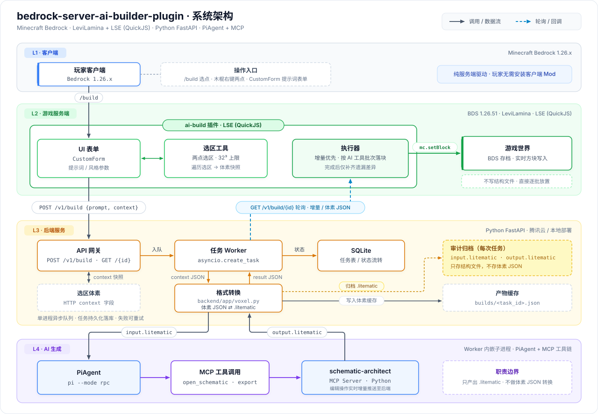

# bedrock-server-ai-builder-plugin

Minecraft Bedrock（基岩版）服务器里的 AI 建造插件：玩家游戏内两点选区 + 一句提示词，由 AI 生成结构并实时增量放置到世界里，**无需安装任何客户端 Mod**。



## 项目结构

```text
plugin/                 LSE (QuickJS) 游戏服插件：UI 表单、两点选区、增量轮询、mc.setBlock 执行器
backend/                Python FastAPI 后端：任务队列、SQLite、体素 ⇄ .litematic 转换、Pi RPC 调度
  └── vendor/           内嵌的 .litematic 解析与 Java → 基岩版方块状态映射 / 转换模块
mcp/
  └── schematic-architect/  内嵌的 MCP 建筑设计服务端（含增量推送至后端的适配改动）
agent/                  PiAgent 工作目录：AGENTS.md、MCP 配置与一键注册脚本
docs/                   系统架构图与接口文档
```

## 数据流

```text
玩家 /build
  → 木棍右键两点选区，弹出表单（提示词 + 风格）
  → 插件采样选区体素 context，POST /v1/build（立即返回 task_id）
  → 后端 Worker 将 context 转为 input.litematic
  → PiAgent 调用内嵌 MCP schematic-architect（open_schematic 并编辑）
  → MCP 每次编辑实时增量推送至后端，插件轮询并立即 mc.setBlock 落块
  → 生成结束后后端将 output.litematic 转为体素 JSON，插件补齐遗漏差异
```

## 环境依赖

| 依赖 | 说明 |
|---|---|
| Python 3.11+ | 后端与内嵌 MCP 共用同一套虚拟环境 |
| Node.js + Pi CLI | `npm install -g --ignore-scripts @earendil-works/pi-coding-agent` |
| LeviLamina + LSE QuickJS | 基岩版服务端已安装 `legacy-script-engine-quickjs` |

## 快速部署

### 1. 创建统一 Python 环境并安装依赖

> 后端与内嵌的 `schematic-architect` MCP 共用 `backend/.venv`，无需额外拉取或配置其他仓库。

Windows (PowerShell)：

```powershell
cd backend
python -m venv .venv
.\.venv\Scripts\pip install -r requirements.txt
copy .env.example .env
```

Linux / macOS：

```bash
cd backend
python3 -m venv .venv
./.venv/bin/pip install -r requirements.txt
cp .env.example .env
```

### 2. 安装 Pi 并一键注册内嵌 MCP

```powershell
npm install -g --ignore-scripts @earendil-works/pi-coding-agent
pi
# 进入 TUI 后执行 /login 配置模型 provider
```

回到仓库根目录，运行脚本自动生成路径并注册内嵌的 `schematic-architect`：

```powershell
.\backend\.venv\Scripts\python.exe agent\setup_mcp.py
pi mcp list
```

### 3. 启动后端服务

```powershell
cd backend
.\.venv\Scripts\python -m uvicorn app.main:app --host 0.0.0.0 --port 8000
```

健康检查：

```powershell
curl.exe http://127.0.0.1:8000/health
```

### 4. 部署基岩版插件

将 `plugin/` 复制到服务器 `plugins/ai_build/`，按需修改 `config.json` 后重启服务器：

```json
{
  "backend": "http://127.0.0.1:8000",
  "pollMs": 1000,
  "batchSize": 800,
  "maxSize": 32,
  "palette": "oak"
}
```

若后端部署在独立云服务器，将 `backend` 改为对应公网地址。

## 游戏内命令

| 命令 | 说明 |
|---|---|
| `/build` | 进入选点模式（木棍右键两点自动弹出提示词表单） |
| `/build status` | 查看当前建造任务进度 |
| `/build cancel` | 取消当前任务 |

## 已知限制

- 3D 选区上限 `32×32×32`（2D 选区支持在平面范围内向上自由建高）
- 常用建筑方块与朝向状态已做映射，冷门方块会降级为相近方块
- 需要为 Pi CLI 配置可用的模型 provider

## 引用项目与致谢

本项目内嵌并适配了以下开源项目，感谢原作者的开源工作：

- [BarnieBarnie/schematic-architect](https://github.com/BarnieBarnie/schematic-architect)（MIT License）：位于 `mcp/schematic-architect/`，在此基础上增加了编辑增量推送（`AI_BUILD_PUSH_BASE`）等服务端适配。
- [3412941994/litematic-to-mcstructure](https://github.com/3412941994/litematic-to-mcstructure)：位于 `backend/vendor/`，用于 `.litematic` 解析、Java → 基岩版方块状态映射及 `.mcstructure` 转换。
